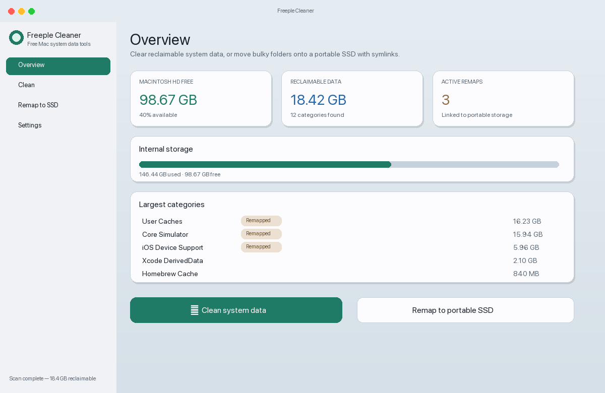
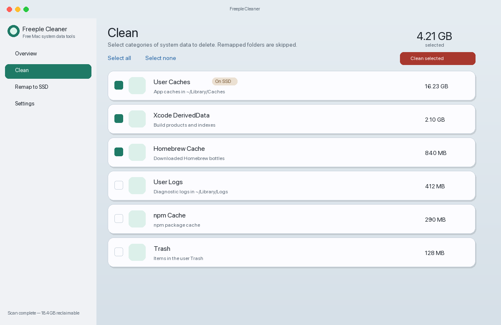
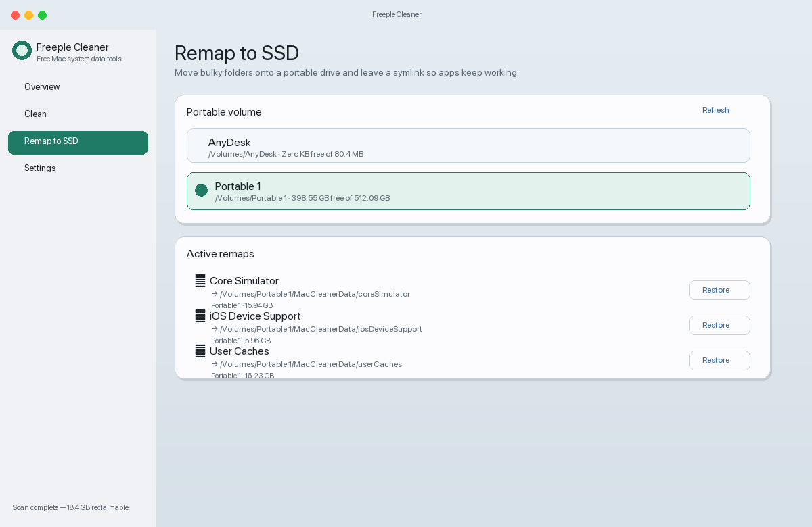
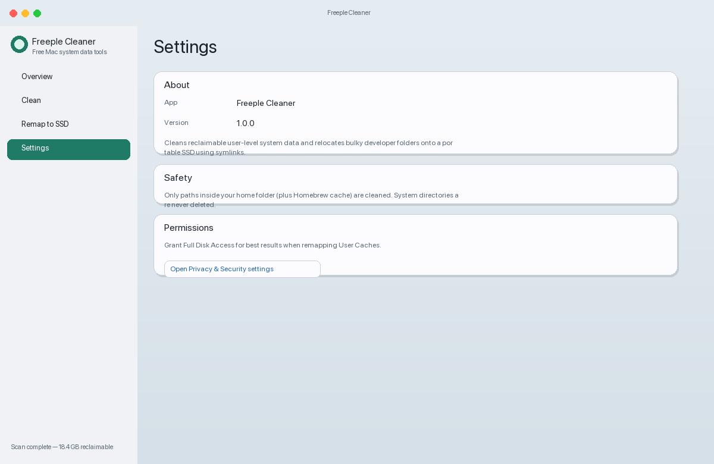

<p align="center">
  
</p>

<h1 align="center">Freeple Cleaner</h1>

<p align="center">
  <strong>Free macOS utility to reclaim system data — or remap bulky folders onto a portable SSD.</strong>
</p>

<p align="center">
  <a href="https://github.com/emondd4/freeple-cleaner/releases"></a>
  <a href="#install"></a>
  <a href="#license"></a>
</p>

<p align="center">
  <a href="#install">Install</a> ·
  <a href="#features">Features</a> ·
  <a href="#interface">Interface</a> ·
  <a href="#remap-to-ssd">Remap to SSD</a> ·
  <a href="#build-from-source">Build</a> ·
  <a href="#safety">Safety</a>
</p>

---

## Why Freeple Cleaner?

macOS “System Data” can quietly eat tens of gigabytes — Xcode DerivedData, simulators, local iOS backups, caches, and more. Commercial cleaners lock the useful bits behind a paywall.

**Freeple Cleaner** is free and open source. It helps you:

1. **See** what is reclaimable on your Mac  
2. **Clean** safe user-level categories with one click  
3. **Remap** large folders to a portable SSD with symlinks so apps keep working while your internal drive breathes again  

---

## Install

### Option A — Download the DMG (recommended)

1. Grab the latest disk image from **[Releases](https://github.com/emondd4/freeple-cleaner/releases)**  
   or download directly: [`dist/FreepleCleaner-1.0.0.dmg`](dist/FreepleCleaner-1.0.0.dmg)
2. Open the DMG  
3. Drag **Freeple Cleaner** into **Applications**  
4. Launch it from Applications  

> **First launch on macOS:** if Gatekeeper blocks the app (*“cannot be opened because it is from an unidentified developer”*), go to  
> **System Settings → Privacy & Security → Open Anyway**.

### Option B — Build from source

See [Build from source](#build-from-source).

---

## Features

| Feature | What it does |
| --- | --- |
| **Smart scan** | Measures reclaimable categories: caches, logs, Xcode data, simulators, backups, package-manager caches, Trash, and more |
| **Selective clean** | Delete only what you select — remapped folders are skipped automatically |
| **Remap to SSD** | Move bulky folders to your portable drive and leave a symlink at the original path |
| **Restore** | Move remapped data back to the internal disk when you want |
| **Live volumes** | Detects connected portable drives and shows free space |
| **Safety rails** | Never touches `/System`, `/Library` roots, or other protected paths |

### Categories you can clean

- User Caches & Logs  
- Temporary files  
- Xcode DerivedData / Archives / iOS Device Support  
- Core Simulator  
- Local iOS device backups  
- Homebrew / npm / pip / Cargo caches  
- Trash & Mail downloads  

### Categories you can remap

- User Caches *(per-subfolder; privacy-protected Apple folders may be skipped)*  
- Xcode DerivedData / Archives / Device Support  
- Core Simulator  
- iOS backups  

---

## Interface

### Overview

Storage snapshot, reclaimable totals, active remaps, and shortcuts into Clean or Remap.

<p align="center">
  
</p>

### Clean

Review each category, select what to remove, and free space in one pass.

<p align="center">
  
</p>

### Remap to SSD

Pick a portable volume, move heavy folders onto it, and restore them later if needed.

<p align="center">
  
</p>

### Settings

Safety notes, Full Disk Access shortcut, and remap database location.

<p align="center">
  
</p>

---

## Remap to SSD

Remapping is ideal when you want to **keep** large developer data but offload it from Macintosh HD.

```text
~/Library/Developer/CoreSimulator
        │
        ▼  move + symlink
/Volumes/YourSSD/MacCleanerData/coreSimulator
```

Apps still look in the original path; the symlink points at your SSD.

### Tips

1. Plug in the SSD and select it under **Remap to SSD**  
2. Quit Xcode / Simulators before remapping those folders  
3. Keep the SSD connected while those tools run  
4. Use **Restore** before long trips without the drive  
5. For more User Caches coverage, grant **Full Disk Access** to Freeple Cleaner  

Remap state is saved at:

```text
~/Library/Application Support/MacCleaner/remaps.json
```

---

## Keyboard shortcuts

| Shortcut | Action |
| --- | --- |
| `⌘1` | Overview |
| `⌘2` | Clean |
| `⌘3` | Remap to SSD |
| `⌘4` | Settings |
| `⌘R` | Scan now |
| `⌘K` | Clean selected |

---

## Build from source

**Requirements:** macOS 14+, Xcode 15+

```bash
git clone https://github.com/emondd4/freeple-cleaner.git
cd freeple-cleaner
open MacCleaner.xcodeproj
```

In Xcode: select the **MacCleaner** scheme → **Product → Run** (`⌘R`).

### Release + DMG

```bash
./scripts/make-dmg.sh
# → dist/FreepleCleaner-1.0.0.dmg
```

---

## Safety

- Cleans **user-level** paths only (home folder + Homebrew cache)  
- Does **not** delete system frameworks or OS components  
- Cleaning is permanent (not a soft “move to Trash”, except when emptying Trash itself)  
- Remaps use move + symlink; unplugging the SSD can break remapped apps until you reconnect or restore  

Use Freeple Cleaner at your own risk. Review selections before cleaning.

---

## Project layout

```text
freeple-cleaner/
├── MacCleaner/                 # SwiftUI app sources
│   ├── Models/
│   ├── Services/               # scan, clean, remap, volumes
│   ├── Views/
│   └── Utilities/
├── docs/screenshots/           # README screenshots
├── dist/FreepleCleaner-1.0.0.dmg
├── scripts/make-dmg.sh
└── MacCleaner.xcodeproj
```

---

## Roadmap

- [ ] Notarized Developer ID builds  
- [ ] Docker / Android SDK remap presets  
- [ ] Scheduled scans  
- [ ] Menu-bar quick clean  

PRs welcome.

---

## License

MIT © Freeple Cleaner contributors

---

<p align="center">
  Made for Macs that need room to breathe — without paying for a cleaner.
</p>
