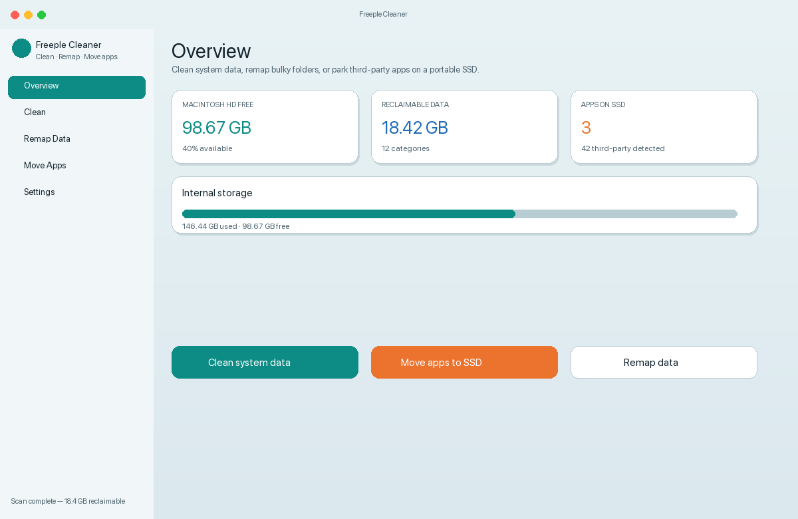
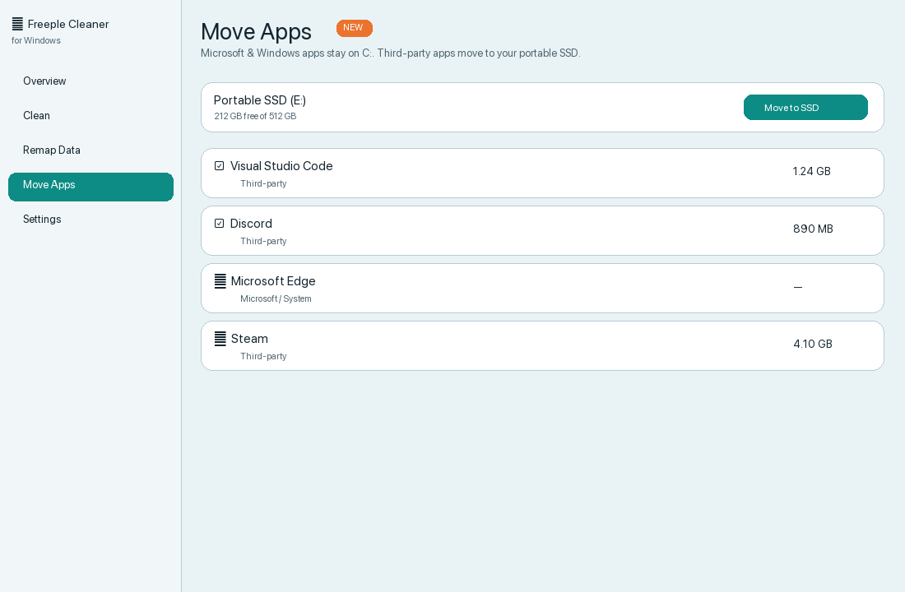
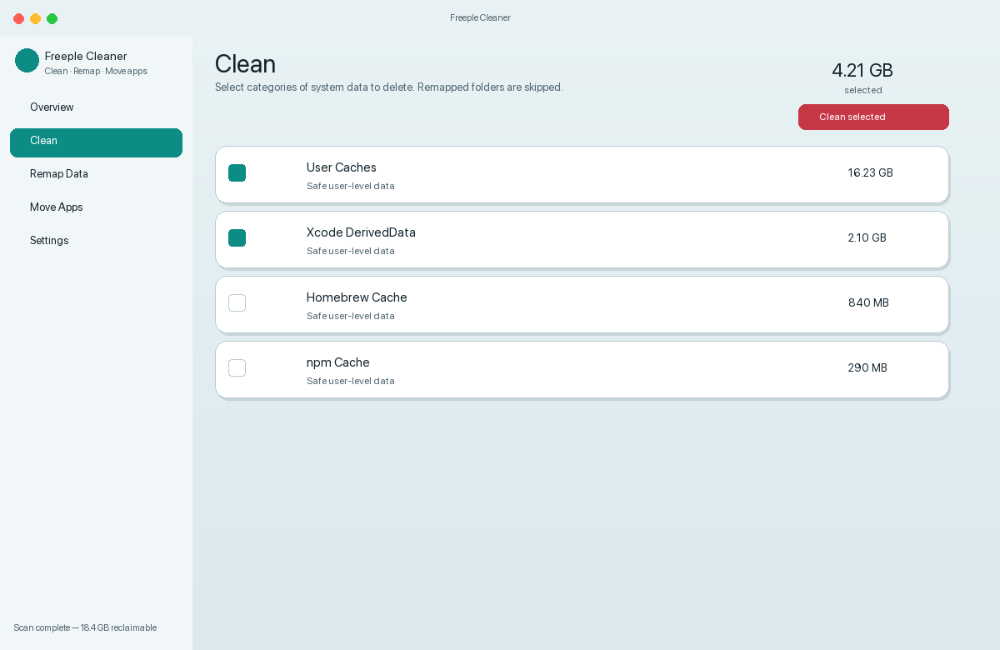
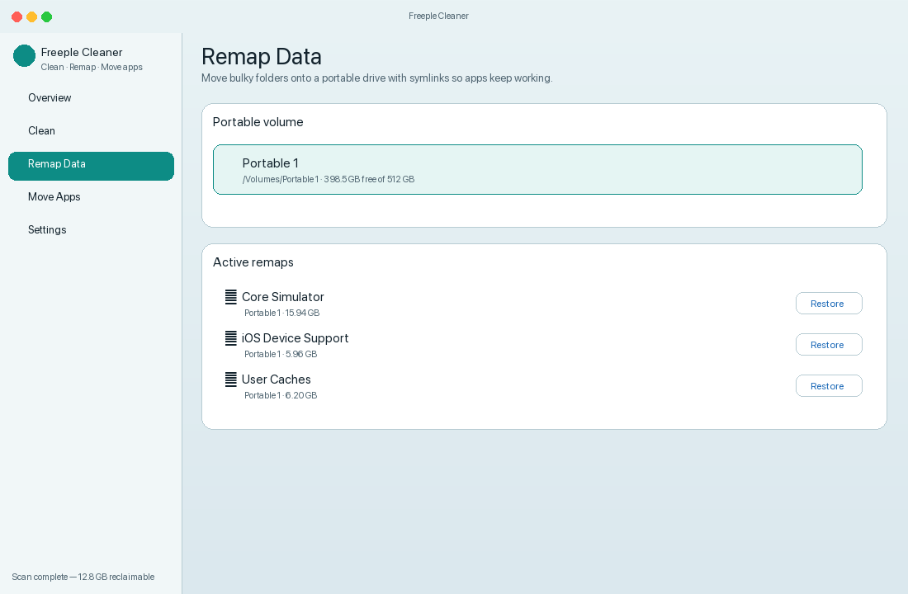
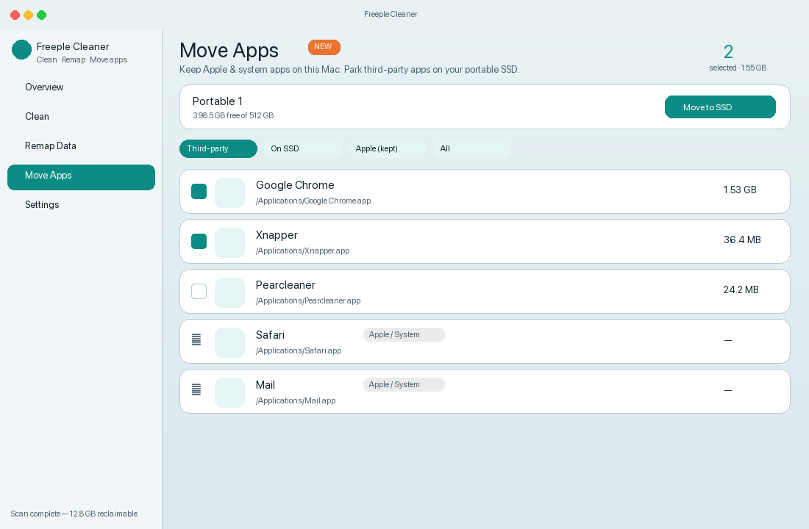
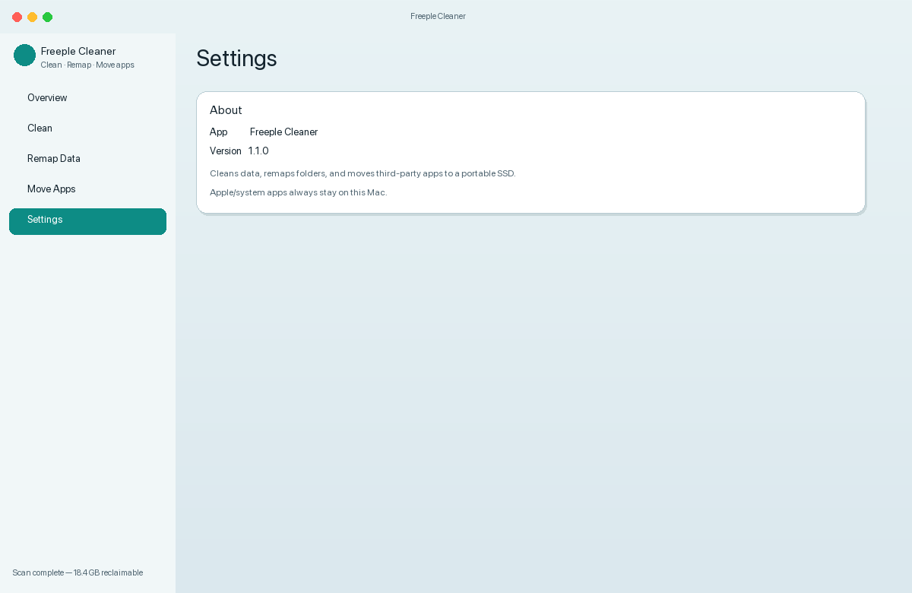

<p align="center">
  
</p>

<h1 align="center">Freeple Cleaner</h1>

<p align="center">
  <strong>Free system cleaner for macOS & Windows — reclaim space, remap data, move third-party apps to a portable SSD.</strong>
</p>

<p align="center">
  <a href="https://github.com/emondd4/freeple-cleaner/releases/download/v1.1.0/FreepleCleaner-1.1.0.dmg"></a>
  <a href="windows/README.md"></a>
  <a href="#license"></a>
</p>

<p align="center">
  <a href="#install-macos">Install macOS</a> ·
  <a href="#install-windows">Install Windows</a> ·
  <a href="#features">Features</a> ·
  <a href="#interface">Interface</a> ·
  <a href="#move-apps">Move Apps</a> ·
  <a href="#safety">Safety</a>
</p>

---

## Why Freeple Cleaner?

System Data and large third-party apps quietly eat internal SSD space. Paid cleaners lock the useful tools.

**Freeple Cleaner** is free and open source on **macOS** and **Windows**:

1. **Clean** reclaimable caches, logs, and temp data  
2. **Remap** bulky folders onto a portable drive (symlinks / junctions)  
3. **Move Apps** — park **third-party** apps on the portable SSD while **Apple / Microsoft / system apps stay on the device**

---

## Install (macOS)

1. Download **[FreepleCleaner-1.1.0.dmg](https://github.com/emondd4/freeple-cleaner/releases/download/v1.1.0/FreepleCleaner-1.1.0.dmg)**  
   (or see all builds on **[Releases](https://github.com/emondd4/freeple-cleaner/releases)**)
2. Open the DMG → drag **Freeple Cleaner** into **Applications**
3. Launch from Applications  

> If Gatekeeper blocks the app: **System Settings → Privacy & Security → Open Anyway**.  
> For best remapping results, grant **Full Disk Access**.

```bash
git clone https://github.com/emondd4/freeple-cleaner.git
cd freeple-cleaner
open MacCleaner.xcodeproj   # Run in Xcode
# or: ./scripts/make-dmg.sh
```

---

## Install (Windows)

Requires **Windows 10/11** and **Python 3.10+** (stdlib only).

```bat
cd windows
python -m freeple_cleaner
```

Or double-click `windows\run_freeple.bat`.

See [windows/README.md](windows/README.md) for details.

<p align="center">
  
</p>

---

## Features

| Feature | macOS | Windows |
| --- | :---: | :---: |
| Scan reclaimable system / user data | ✅ | ✅ |
| Selective clean with safety rails | ✅ | ✅ |
| Remap bulky folders to portable SSD | ✅ symlinks | ✅ junctions |
| **Move third-party apps to SSD** | ✅ | ✅ |
| Keep Apple / Microsoft / system apps on device | ✅ | ✅ |
| Restore apps & folders later | ✅ | ✅ |

### Move Apps (new)

- Lists installed applications  
- **Locks** Apple/system (Mac) or Microsoft/Windows (PC) apps — they never move  
- Moves selected third-party apps to `…/MacCleanerData/Apps` or `…/FreepleCleanerData/Apps`  
- Leaves a **symlink** (macOS) or **directory junction** (Windows) so Launchpad / Start Menu still resolve  
- **Restore** brings an app back to the internal disk  

Keep the portable drive plugged in while using remapped apps.

---

## Interface

### Overview

Storage snapshot, reclaimable totals, apps already on SSD, and quick actions.

<p align="center">
  
</p>

### Clean

Pick categories (caches, Xcode data, package managers, Trash, and more) and free space in one pass.

<p align="center">
  
</p>

### Remap Data

Move bulky folders (DerivedData, simulators, caches, …) onto the SSD with links left behind.

<p align="center">
  
</p>

### Move Apps

Third-party apps are selectable. Apple / system apps stay locked on the Mac.

<p align="center">
  
</p>

### Settings

Safety notes, Full Disk Access, and remap database paths.

<p align="center">
  
</p>

---

## Keyboard shortcuts (macOS)

| Shortcut | Action |
| --- | --- |
| `⌘1` | Overview |
| `⌘2` | Clean |
| `⌘3` | Remap Data |
| `⌘4` | Move Apps |
| `⌘5` | Settings |
| `⌘R` | Scan now |
| `⌘K` | Clean selected |

---

## Safety

- Cleans **user-level** data only — not OS frameworks  
- **Apple / Microsoft / system apps are never moved**  
- Cleaning is permanent (except emptying Trash / Recycle Bin itself)  
- Remapped apps & folders need the portable drive connected  
- Quit apps before moving them for best results  

Use at your own risk — review selections before cleaning or moving.

---

## Project layout

```text
freeple-cleaner/
├── MacCleaner/                 # SwiftUI macOS app
│   ├── Models/
│   ├── Services/               # scan, clean, remap, app mover
│   └── Views/                  # Overview, Clean, Remap, Move Apps, Settings
├── windows/                    # Windows companion (Python)
│   ├── freeple_cleaner/
│   └── run_freeple.bat
├── docs/screenshots/
├── dist/                       # macOS DMG builds
└── scripts/make-dmg.sh
```

---

## Version

**1.1.0** — Move Apps for third-party software, refreshed UI colors, Windows companion.

---

## License

MIT © Freeple Cleaner contributors

---

<p align="center">
  Made for machines that need room to breathe — without paying for a cleaner.
</p>
